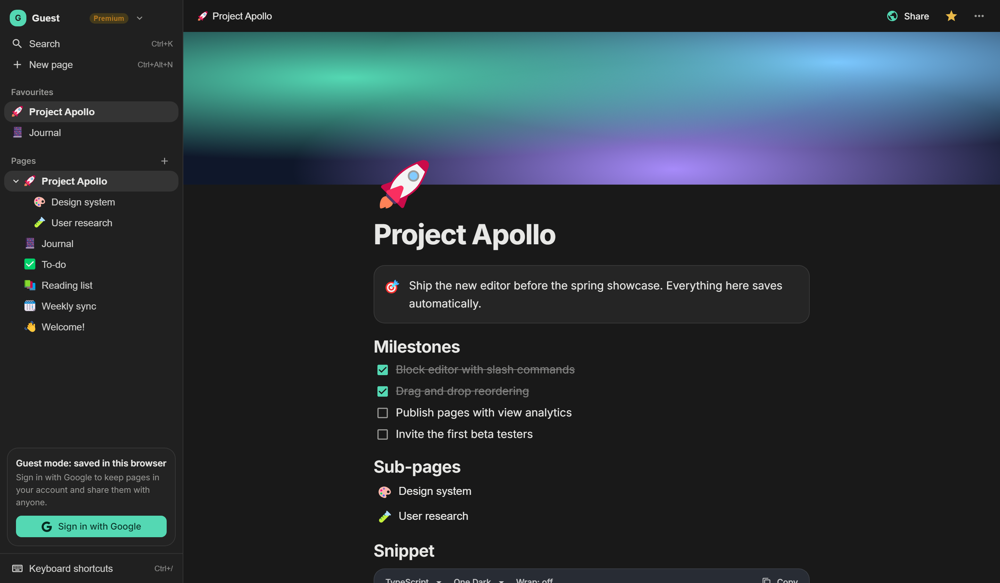

<div align="center">

# 🚀 Opal Labs: A Notion-Style Note-Taking App (Frontend)

A Notion-like notes and productivity app built with **Next.js, TypeScript and Material UI**: rich text, nested pages, web embeds, one-click publishing, Google sign-in, and a **guest mode that needs no account**.

<a href="https://opal-labs.vercel.app/" target="_blank" rel="noreferrer">
  
</a>

<br />

[🌐 Live Demo](https://opal-labs.vercel.app/) (click **Demo**) •
[🛠 Backend Repo](https://github.com/AbdulDevHub/Opal-Labs-Backend)

<br />

[](https://github.com/AbdulDevHub/Opal-Labs-Frontend/actions/workflows/ci.yml)
[](https://github.com/AbdulDevHub/Opal-Labs-Frontend/actions/workflows/playwright.yml)


</div>

---

## ✨ Introduction

This is a **public copy of a private repository** where I am collaborating with a **team of 7 developers** to build a Notion-like productivity application.

This repository contains the **frontend** portion of the project.  
For the backend implementation, visit 👉 **[Opal Labs Backend](https://github.com/AbdulDevHub/Opal-Labs-Backend)**

### 🧭 Project Overview

Opal Labs is a Notion-style notes app. You create pages and fill them with blocks: headings, lists, to-dos, quotes,
callouts, code, images, embedded videos or websites, sub-pages and a views chart. Typing `/` opens a menu of blocks,
Markdown shortcuts like `#` or `-` work as you type, blocks can be dragged around, and everything saves automatically.
Pages get emoji icons and covers, there are starter templates, a `Ctrl+K` search, light and dark themes, and any page can
be published as a read-only link.

This repo is the website. It talks to a separate Go server that stores pages in Postgres; users sign in with Google and
the server hands back a signed token that proves who they are on every request. Visitors can also press **Demo** to use
the whole app without an account: pages are then saved in the browser instead of the server. The homepage itself is a
live piece: an animated opal drawn with a WebGL shader and a playable copy of the real editor.

### 🌟 Features

- **Block editor:** type `/` for a command menu (headings, lists, to-dos, quotes, callouts, dividers, code, images, web embeds, sub-pages, a views chart), or use Markdown shortcuts (`#`, `-`, `1.`, `[]`, `>`, `---`, ` ``` `)
- **Keyboard first:** Enter splits a block, Backspace merges, arrows move between blocks, `Ctrl/⌘+K` opens a search and command palette, `Ctrl/⌘+/` lists every shortcut
- **Drag and drop** blocks by their handle; the handle's menu turns blocks into other types, colours them, duplicates, moves or deletes them
- **Autosave** with a live "Saving… / Saved" status (no Save button)
- **Nested pages** in a collapsible sidebar tree with favourites, rename, duplicate and delete, plus breadcrumbs
- **Page icons and covers** (emoji picker, gradient presets or an image link), full-width and lock options
- **Templates** for empty pages (to-do list, meeting notes, journal, project brief, reading list) and **Markdown export**
- **Publish to web** with a copyable link, a clean reading view with a table of contents, and a page-views chart
- **Light, dark or system theme**, responsive down to phone size
- **Guest mode:** try everything without signing in; pages are saved in the browser
- **A 404 page with personality:** the living opal stands in for the zero

### 🧱 Tech Stack

- **Framework:** Next.js (Pages Router), React, Material UI, dnd-kit
- **Language:** TypeScript
- **Auth:** Google OAuth 2.0 via NextAuth, plus a browser-only guest mode
- **Database:** PostgreSQL (Neon)
- **Caching:** Redis (optional)
- **Testing:** Playwright end-to-end tests, Storybook
- **Backend Language:** Go
- **Hosting:** Vercel (frontend), Render (backend)
- **Methodology:** Agile

---

## 🛠 Setup

```bash
yarn install
```

1. Install all required workspace `@recommended` extensions
2. Add the required `.env` values from the team drive

---

## 🚀 Getting Started

Start the development server:

```bash
yarn dev
```

Then open:

👉 **[http://localhost:3000](http://localhost:3000)**

---

## 🔐 Google OAuth 2.0

Follow the instructions in the shared document:

👉 [Google OAuth 2.0 Setup Guide](https://drive.google.com/drive/folders/1PWzpsJGXIDA_RnRRoEcJe_U5yvGC6s_U?usp=sharing)

---

## 📘 Storybook

Run Storybook on port **6000**:

```bash
yarn storybook
```

---

## 🧪 Testing & Quality Checks

Run linting and type checks:

```bash
yarn lint
yarn check-types
```

These commands run:

- **Pre-push** via `husky`
- **CI/CD** via GitHub Actions

---

## 🎭 Playwright Testing

Playwright runs **end-to-end tests** in guest mode, so no backend or Google keys are needed. They cover the homepage
(sections, theme switch, playground, 404), the editor (slash menu, Markdown shortcuts, split/merge, block menu), the sidebar
(rename, favourite, duplicate, delete), sub-pages and breadcrumbs, page options, templates, the command palette, themes and
the phone layout. CI runs them on every push.

```bash
npx next build && npx next start -p 3000   # in one terminal
npx playwright install chromium            # first time only
npx playwright test                        # add --ui to watch, or --workers=1 on a slow machine
npx playwright show-report
```

To test the live site instead: `PLAYWRIGHT_BASE_URL=https://opal-labs.vercel.app npx playwright test`.

📚 Learn more: [Playwright Documentation](https://playwright.dev/docs/intro)

---

## 🤝 Contributing

Contributions are welcome!

- Open an issue for bugs or feature requests
- Submit a PR for improvements

---

## 📄 License

This project is licensed under the **MIT License**.
See the [LICENSE](LICENSE) file for details.
